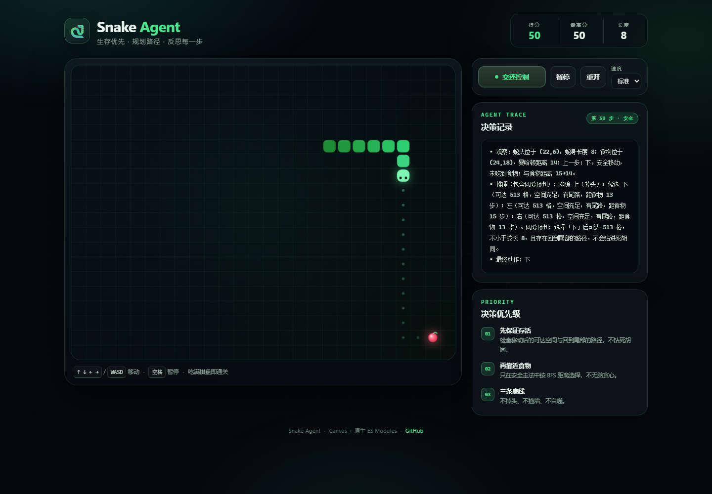

# Snake Agent 🐍

一个**生存优先、会规划路径、能反思上一步**的贪吃蛇游戏。

普通贪吃蛇只会朝食物直线前进；这个 Agent 每一步都会先问自己：**“我吃得掉这口食物，但我还出得来吗？”** 它会用 BFS 评估每个候选方向移动后的可达空间、回到尾部的路径与食物距离，并输出严格的「观察 / 推理 / 最终动作」决策记录。

[**▶ 在线试玩**](https://fish0226-hub.github.io/snake-agent/) · [**AI 演示模式**](https://fish0226-hub.github.io/snake-agent/?demo=1)



## 特性

- 🎮 原生 Canvas 贪吃蛇，键盘 / 触屏方向键均可操作
- 🤖 一键 AI 接管，实时展示每一步的思考过程
- 🧠 生存优先：移动后可达空间不足蛇长，或没有回到尾部的路径，直接排除
- 🍎 拒绝无脑贪心：只在安全走法里按 BFS 距离靠近食物
- 🚫 三条底线：不掉头、不撞墙、不自噬
- 🔁 反思机制：上一步的结果（是否吃到、距离变化）会进入下一步观察
- 📱 响应式界面，支持手机、桌面与 `prefers-reduced-motion`
- ✅ 零运行时依赖，8 个 Agent 单元测试

## 玩法

| 操作 | 按键 |
| --- | --- |
| 移动 | `↑` `↓` `←` `→` 或 `W` `A` `S` `D` |
| 暂停 / 继续 | `空格` |
| 重开 | 界面按钮 / 游戏结束后按 `空格` |
| 接管 | 点击「AI 接管」，再按方向键可随时交还手动控制 |

吃到食物得 10 分；填满整个棋盘即可通关。最高分保存在 `localStorage`。

## Agent 决策逻辑

每一步，Agent 会枚举 `上 / 下 / 左 / 右` 四个候选动作：

1. **淘汰非法动作**：越界、掉头、撞到蛇身（尾巴将要让位的格子除外）。
2. **模拟移动**：更新蛇身，若吃到食物则增长。
3. **检查逃生空间**：从新蛇头做洪泛填充（flood fill），统计可达空格数。
   - `可达空间 ≥ 新蛇长` 才视为安全；
   - 再用 BFS 检查新蛇头是否能回到蛇尾，避免“空间够但其实是死胡同”。
4. **选择动作**：
   - 安全且有尾路 → 安全但无尾路 → 仅合法（空间最大）；
   - 同一档内优先食物路径最短，再优先可达空间更大。
5. **生成反思**：记录本步是否吃到食物、与食物距离的变化，供下一步观察使用。

```text
安全且有尾路  >  安全但无尾路  >  仅合法（尽量拖延）
      │                │                    │
      └── 食物 BFS 距离最短 ── 可达空间更大 ──┘
```

> 这是一个启发式策略，不宣称永不死亡：它保证的是“不主动走进一步可见的死胡同”，而不是全局最优。测试中它通常能活到 1,000+ 步、蛇长 60–110 节。

## 严格输出格式

Agent 的每一次决策都会渲染成下面三行：

```text
• 观察：蛇头位于 (22,6)，蛇身长度 8；食物位于 (24,18)，曼哈顿距离 14；上一步：下，安全移动，未吃到食物；与食物距离 15→14。
• 推理（包含风险预判）：排除 上（掉头）；候选 下（可达 513 格，空间充足，有尾路，距食物 13 步）；左（可达 513 格，空间充足，有尾路，距食物 15 步）；右（可达 513 格，空间充足，有尾路，距食物 13 步）。风险预判：选择「下」后可达 513 格，不小于蛇长 8，且存在回到尾部的路径，不会钻进死胡同。
• 最终动作：下
```

对应的状态占位符：

| 模板占位符 | 游戏中的来源 |
| --- | --- |
| `{{w}}` / `{{h}}` | 棋盘宽 26 / 高 20 |
| `{{hx}}` / `{{hy}}` | `snake[0]` 蛇头坐标 |
| `{{body_list}}` | 完整的蛇身坐标数组（头在前） |
| `{{fx}}` / `{{fy}}` | 食物坐标 |
| `{{last_step_reflect}}` | 上一步动作、结果与距离变化；首步为 `首次` |

## 本地运行

项目是纯静态页面，无需构建。由于使用了 ES Modules，请通过 HTTP 访问，不要直接双击 `index.html`。

```bash
# 任选一种
python -m http.server 4173
# 或
npx serve . -l 4173
```

打开 <http://127.0.0.1:4173/>。

演示模式：<http://127.0.0.1:4173/?demo=1> 会自动开启 AI 接管。

## 测试

```bash
npm test
```

测试覆盖：

- 拒绝掉头（长度为 2 时同样成立）
- 角落不撞墙
- 食物在死胡同内时，不因贪心进入空间不足区域
- 有安全走法时必定选择安全走法
- 洪泛填充与 BFS 最短路正确性
- 三行严格输出格式
- 上一步反思信息进入下一步观察

## 项目结构

```text
snake-agent/
├── index.html            # 页面结构
├── styles.css            # 深色霓虹主题与响应式布局
├── src/
│   ├── agent.js          # 决策器：模拟、BFS、安全评估、格式化输出
│   └── game.js           # 游戏循环、Canvas 渲染、输入与 UI
├── tests/
│   └── agent.test.js     # node:test 单元测试
├── docs/
│   └── preview.png       # 截图
└── package.json
```

## License

[MIT](LICENSE) © 2026 fish0226-hub
